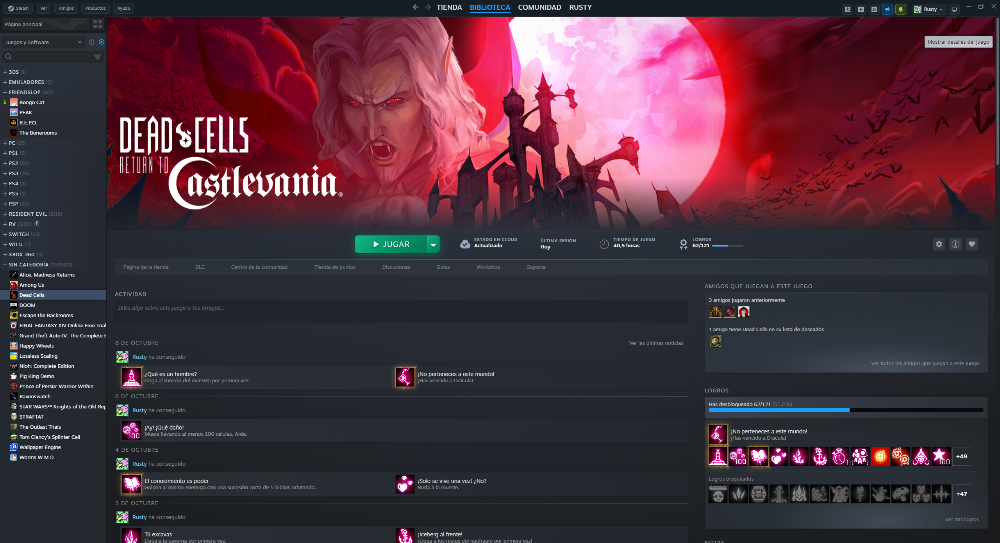
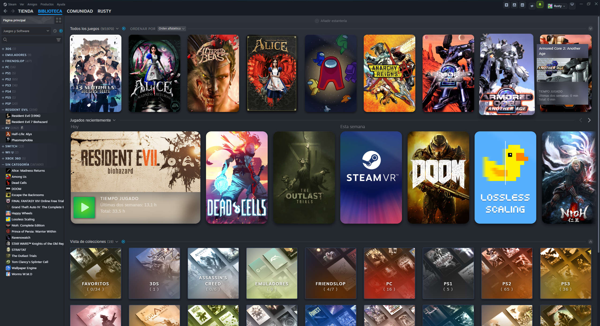
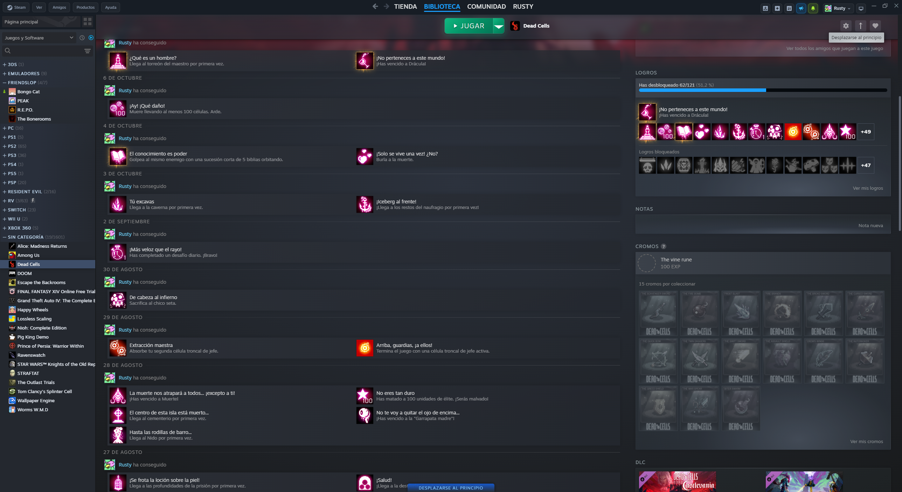

# Better Desktop for Steam 🎮✨

A modern, sleek, and highly customizable theme for the **Steam Desktop Client**, designed specifically for **CSS Loader**.

Transform your Steam desktop client with unified single-row navigation, centered game details, customizable color palettes (including **Cyberpunk 2077** and **Rusty**), compact capsule buttons, and repositioned bottom-bar controls.

---

## 🌟 Highlights

- **🎯 Centered Game Action Bar:** Reimagined game details view with a centered Play/Install button, glowing state-based neon accents, achievements progress bar, and floating sticky header support.
- **⚡ Unified Single-Row Header:** Consolidates Steam's top bar into a clean 42px header with centered store navigation or centered classic menu.
- **🚀 Buttons on Top:** Moves the Downloads monitor, Add Game button, and Friends list from the bottom footer to the top-right header for a clean, borderless client.
- **🎨 Custom Color Palettes:**
  - **Cyberpunk 2077:** Electric yellow (`#fcee0a`), neon cyan (`#00f0ff`), deep obsidian carbon, and glowing neon text/accent shadows.
  - **Rusty:** Industrial warm amber, molten copper, and charcoal tones.
  - **Default:** Retains native Steam colors while enjoying layout and button tweaks.
- **💊 Capsule Buttons Style:** Modern glassmorphism capsules with subtle borders, glowing hover states, and compact 28x28 system chips.
- **📐 Scalable Shelf & Banner Sizes:** Customize hero banner heights (up to 550px) and recently played shelf scales (from 100% up to 150%).

---

## 🖼️ Preview

<p align="center">
  <b>🎮 Centered Game Action Bar & Extra Large Hero Banner</b><br>
  <i>Modern centered Play button with state gradients, achievements progress, and quick controls.</i><br>
  
</p>

<p align="center">
  <b>📚 Library Home & Unified Header</b><br>
  <i>Single-row 42px header, classic menu in capsules, moved top controls, and scaled shelves.</i><br>
  
</p>

<p align="center">
  <b>📌 Sticky Floating Play Bar (Scrolled View)</b><br>
  <i>The centered play bar seamlessly attaches to the top when scrolling down game details.</i><br>
  
</p>

---

## ⚙️ Customization Options

All features are modular and can be toggled or configured directly through the **CSS Loader Theme Settings** menu:

| Setting | Options | Description |
| :--- | :--- | :--- |
| **Theme Color** | `Default`, `Rusty`, `Cyberpunk 2077` | Accent colors, library background gradients, glow effects, and button themes. |
| **Buttons Style** | `Capsules`, `Default` | Rounded glass capsule buttons with hover glow or classic flat Steam buttons. |
| **Game Action Bar** | `Centered`, `Default` | Centers the Play button, game status, and actions on the game page. |
| **Classic Menu** | `Unified (Centered Nav)`, `Unified (Centered Menu)`, `Default` | Merges header into a single row with centered navigation or centered Steam menu. |
| **Bottom Bar** | `Buttons on Top`, `Default`, `Hidden` | Moves action buttons to the top header, hides footer, or leaves native bottom bar. |
| **Hero Banner Size** | `Large (480px)`, `Extra Large (550px)`, `Default` | Increases the hero image height on game library pages. |
| **Recent Games Size** | `100%`, `115%`, `125%`, `135%`, `150%` | Custom zoom scale for recently played game capsules on the home shelf. |

---

## 📥 Installation

### Windows (CSS Loader Desktop)

1. Make sure you have [CSS Loader Desktop](https://github.com/suchmememanyskill/CSS-Loader) installed and running.
2. Clone or download this repository into your CSS Loader themes folder:
   ```bash
   git clone https://github.com/stefan0704/Better-Desktop.git "%USERPROFILE%\homebrew\themes\Better Desktop"
   ```
   Or extract/place the `Better Desktop` folder manually into:
   ```
   C:\Users\<YourUser>\homebrew\themes\Better Desktop
   ```
3. Open CSS Loader Desktop, locate **Better Desktop**, enable it, and customize your settings.

### Steam Deck / SteamOS (Decky Loader + CSS Loader)

1. Ensure you have [Decky Loader](https://github.com/SteamDeckHomebrew/decky-loader) and the **CSS Loader** plugin installed.
2. Place the `Better Desktop` folder in your themes directory:
   ```bash
   ~/homebrew/themes/Better Desktop
   ```
3. Open the Quick Access Menu (`...`), navigate to **Decky > CSS Loader**, enable **Better Desktop**, and pick your preferred options.

---

## 🛠️ File Structure

```
Better Desktop/
├── theme.json                          # CSS Loader theme manifest & patches
├── desktop.css                         # Base desktop CSS
├── preview/                            # Showcase screenshots for GitHub
│   ├── game_details.png
│   ├── library_home.png
│   └── game_sticky_bar.png
├── colors/
│   ├── cyberpunk.css                   # Cyberpunk 2077 color scheme
│   └── rusty.css                       # Warm industrial rusty color scheme
├── tweaks/
│   ├── action_bar_centered.css         # Centered game page action bar
│   ├── bottombar_move_top.css          # Repositioned bottom bar controls
│   ├── bottombar_hide.css              # Hidden bottom bar
│   ├── buttons_capsules.css            # Capsule style buttons
│   ├── hero_large.css / hero_xlarge.css# Scaled hero banner heights
│   ├── menu_single_row.css             # Unified header (centered nav)
│   ├── menu_single_row_centered_menu.css# Unified header (centered menu)
│   └── recent_*.css                    # Scaled recently played shelves
└── DOCUMENTACION.md                    # Comprehensive CEF theme development technical guide
```

---

## 💡 Notes & Troubleshooting

- **Switching Themes / Options:** Changes made in CSS Loader apply immediately. If a UI element doesn't update, press `F5` in Steam or reload the client.
- **Default Mode:** Every tweak is designed to revert cleanly to Steam's native appearance when set to `Default`.
- **ASCII Compatibility:** All theme stylesheets maintain 100% 7-bit ASCII encoding for seamless compatibility with Windows local codecs.

---

## 📄 License & Credits

Created by **stefan0704**.  
Built for the Steam community with support for **CSS Loader**.
